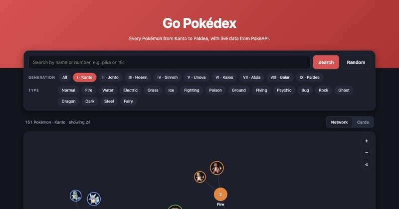
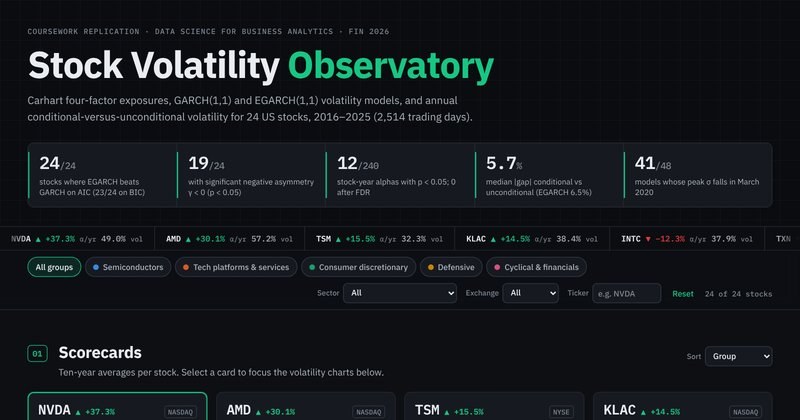
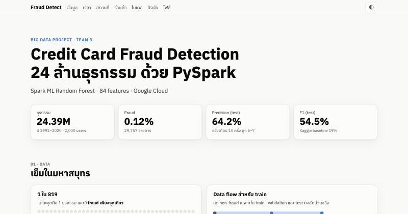

<h1>⚡️ <i>I'm PhuPhu</i></h1>

  Hi, I'm a <strong><i>Data Engineer</i></strong> 🇹🇭 — I build data pipelines, ML models and the dashboards that explain them.

<h2>Featured projects</h2>

<table>
  <tr>
    <td width="33%" valign="top">
      
      
<strong>Go Pokédex</strong>

      
A Go API with concurrent fetching, caching and a Pokémon network view.

      
Go · D3.js · Docker

      
<a href="https://tpootth.github.io/go_test_api/">Live site</a> &nbsp;·&nbsp; <a href="https://github.com/tpootth/go_test_api">Code</a>

    </td>
    <td width="33%" valign="top">
      
      
<strong>Stock Volatility Observatory</strong>

      
Carhart four-factor exposures and GARCH/EGARCH volatility for 24 US stocks, 2016–2025.

      
Python · statsmodels · arch · JavaScript

      
<a href="https://tpootth.github.io/stock-volatility-observatory/">Live site</a> &nbsp;·&nbsp; <a href="https://github.com/tpootth/stock-volatility-observatory">Code</a>

    </td>
    <td width="33%" valign="top">
      
      
<strong>Bank Call Prioritization</strong>

      
Rank bank marketing calls and explore practical campaign scenarios.

      
Python · scikit-learn · Plotly

      
<a href="https://tpootth.github.io/finance_tele_promotion_sale/">Live site</a> &nbsp;·&nbsp; <a href="https://github.com/tpootth/finance_tele_promotion_sale">Code</a>

    </td>
  </tr>
  <tr>
    <td width="33%" valign="top">
      
      
<strong>Credit Card Fraud Detection</strong>

      
Fraud detection across 24.4M transactions with Spark ML on Google Cloud.

      
PySpark · Google Cloud

      
<a href="https://tpootth.github.io/fraud_detect/">Live site</a> &nbsp;·&nbsp; <a href="https://github.com/tpootth/fraud_detect">Code</a>

    </td>
    <td width="33%" valign="top">
      
      
<strong>Thai Parliament Votes</strong>

      
Explore 107,826 parliamentary votes by year, party and motion.

      
Observable · D3.js · Python

      
<a href="https://tpootth.github.io/politigraph-viz/">Live site</a> &nbsp;·&nbsp; <a href="https://github.com/tpootth/politigraph-viz">Code</a>

    </td>
    <td width="33%" valign="top">
      
      
<strong>TradingView Indicators</strong>

      
Multi-timeframe Squeeze Momentum indicators and usage guides. Not backtested.

      
Pine Script v6 · TradingView

      
<a href="https://github.com/tpootth/trading">Code</a>

    </td>
  </tr>
</table>

<h3>🧰 <i>More</i></h3>
<ul>
  <li><a href="https://tpootth.github.io/iran-it-gadget-store-sales/"><b>Iran Gadget Sales</b></a> — interactive sales dashboard: monthly trends, product performance, city rankings and customer segments (<a href="https://github.com/tpootth/iran-it-gadget-store-sales">code</a>)</li>
  <li><a href="https://github.com/tpootth/files_transfer_project"><b>files_transfer_project</b></a> — Python scripts that index video files to JSON and batch-convert them to MP4</li>
</ul>

<h2>📑 <i>Familiar with</i></h2>

  <b>Data engineering</b> 
  
  
  
  
  

  <b>Languages &amp; data</b> 
  
  
  
  
  

  <b>Databases</b> 
  
  
  

  <b>Visualization &amp; tools</b> 
  
  
  
  
  

