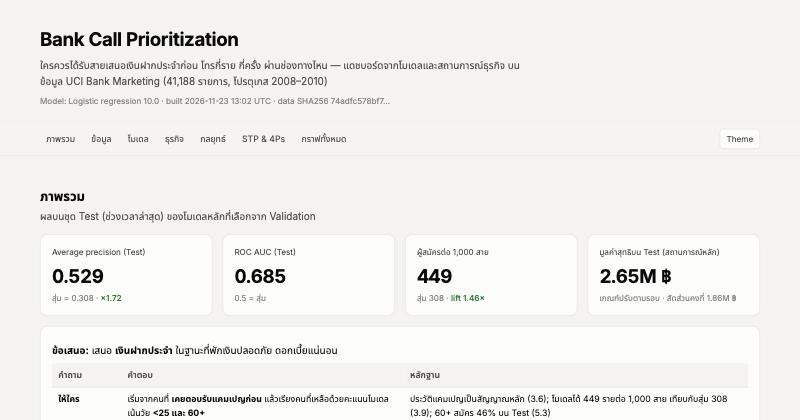

<h1>⚡️ <i>I'm PhuPhu</i></h1>

  Hi, I'm a <strong><i>Data Engineer</i></strong> 🇹🇭 — I build data pipelines, ML models and the dashboards that explain them.

<h2>🚀 <i>Featured projects</i></h2>

<table>
  <tr>
    <td width="50%" valign="top">
      
      <h3><a href="https://tpootth.github.io/finance_tele_promotion_sale/">Bank Call Prioritization</a></h3>
      
Who should a bank call first for a term-deposit offer, how many times and on which channel? Logistic regression ranking + business scenarios on 41k UCI calls — <b>449 subscribers per 1,000 calls vs 308 random</b>. The notebook re-runs in GitHub Actions on every push.

      

        
        
        
        
      

      <a href="https://tpootth.github.io/finance_tele_promotion_sale/">Live dashboard</a> · <a href="https://github.com/tpootth/finance_tele_promotion_sale">Code</a>
    </td>
    <td width="50%" valign="top">
      
      <h3><a href="https://tpootth.github.io/fraud_detect/">Credit Card Fraud Detection</a></h3>
      
Fraud detection on <b>24.4M transactions</b> (0.12% fraud) with Spark ML on Google Cloud. Random Forest on 84 leakage-safe behavioural window features — <b>precision 64% · F1 54.5%</b> on the fraud class.

      

        
        
        
      

      <a href="https://tpootth.github.io/fraud_detect/">Live presentation</a> · <a href="https://github.com/tpootth/fraud_detect">Code</a>
    </td>
  </tr>
  <tr>
    <td width="50%" valign="top">
      
      <h3><a href="https://tpootth.github.io/politigraph-viz/">เสียงในสภา — Thai Parliament Votes</a></h3>
      
How each party voted on 180 motions in the Thai parliament (2020–2025): <b>107,826 votes</b> from Politigraph (WeVis), explorable by year, party and motion.

      

        
        
        
      

      <a href="https://tpootth.github.io/politigraph-viz/">Live site</a> · <a href="https://github.com/tpootth/politigraph-viz">Code</a>
    </td>
    <td width="50%" valign="top">
      
      <h3><a href="https://tpootth.github.io/go_test_api/">Go Pokédex</a></h3>
      
A standard-library-only Go web app + JSON API over PokeAPI, with concurrent fetches and an in-memory cache. The static web version adds a <b>d3 network view</b> linking every Pokémon to its types.

      

        
        
        
      

      <a href="https://tpootth.github.io/go_test_api/">Live app</a> · <a href="https://github.com/tpootth/go_test_api">Code</a>
    </td>
  </tr>
</table>

<h3>🧰 <i>More</i></h3>
<ul>
  <li><a href="https://github.com/tpootth/trading"><b>trading</b></a> — TradingView Pine Script v6 indicators: multi-timeframe Squeeze Momentum with buy/sell signals</li>
  <li><a href="https://github.com/tpootth/files_transfer_project"><b>files_transfer_project</b></a> — Python scripts that index video files to JSON and batch-convert them to MP4</li>
</ul>

<h2>📑 <i>Familiar with</i></h2>

  <b>Data engineering</b> 
  
  
  
  
  

  <b>Languages &amp; data</b> 
  
  
  
  
  

  <b>Databases</b> 
  
  
  

  <b>Visualization &amp; tools</b> 
  
  
  
  
  

